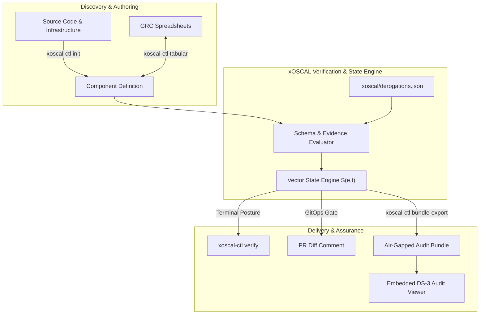

# xOSCAL

<p align="center">
  <picture>
    <source media="(prefers-color-scheme: dark)" srcset="https://shieldcn.dev/header/graph.svg?title=xOSCAL&subtitle=High-Assurance+NIST+OSCAL+Engine+%26+CLI&logo=shield&theme=zinc&mode=dark" />
    
  </picture>
</p>

<p align="center">
  <a href="https://github.com/ckodex-labs/ckodex-xoscal/releases"></a>
  <a href="https://github.com/ckodex-labs/ckodex-xoscal/actions/workflows/ci.yml"></a>
  <a href="https://github.com/ckodex-labs/ckodex-xoscal/blob/main/LICENSE"></a>
  <a href="https://github.com/ckodex-labs/ckodex-xoscal/commits/main"></a>
  <a href="https://github.com/ckodex-labs/ckodex-xoscal/stargazers"></a>
</p>

<p align="center">
  <a href="https://pages.nist.gov/OSCAL/"></a>
  <a href="https://go.dev/"></a>
  <a href="https://dagger.io/"></a>
  <a href="#6-offline-air-gapped-audit-bundles-xoscal-ctl-bundle-export"></a>
  <a href="https://github.com/MChorfa/shieldcn-zig"></a>
</p>

---

> **xOSCAL** is a high-assurance, developer-friendly compliance engine and unified CLI for [NIST OSCAL 1.2.3](https://pages.nist.gov/OSCAL/). It eliminates compliance theater by translating infrastructure and codebases into machine-verifiable governance artifacts, multi-dimensional vector state, GitOps pull-request diffs, spreadsheet round-trips, and air-gapped cryptographic bundles.

Published documentation: [Overview](https://ckodex-labs.github.io/ckodex-xoscal/),
[CLI guide](https://ckodex-labs.github.io/ckodex-xoscal/cli.html),
[API documentation](https://ckodex-labs.github.io/ckodex-xoscal/docs.html),
[Downloads](https://ckodex-labs.github.io/ckodex-xoscal/downloads.html),
[Transparency](https://ckodex-labs.github.io/ckodex-xoscal/transparency.html), and
[SBOM validation](https://ckodex-labs.github.io/ckodex-xoscal/sbom-validation.html).
Key operator guides: [verified installation](docs/INSTALL-CONTRACT.md),
[gRPC usage](docs/GRPC_USAGE_EXAMPLES.md), [operations](docs/OPERATIONS.md),
[Canadian Sovereign Frameworks](docs/CANADIAN-FRAMEWORKS.md), and
[beta scope and evidence boundaries](docs/BETA-CONTRACT.md).
The [Design Blueprint](https://ckodex-labs.github.io/ckodex-xoscal/portal.html)
contains illustrative data; release verification requires the actual pinned proof.

---

## Capability Matrix

| Capability | Persona | Problem Solved | Primary Command |
| :--- | :--- | :--- | :--- |
| **Terminal Control Intelligence** | Developers / Auditors | Full-text control search, AST statements, ODP parameters, guidance, and sovereign Canadian tags | `xoscal controls` |
| **Framework Transition Engine** | GRC Architects / SecOps | Compare frameworks, compute migration deltas (e.g. ITSG-33 -> ITSP.10.033), family breakdown | `xoscal compare` |
| **Zero-Dependency Web Studio** | Compliance Teams / Devs | Embedded local explorer, live control search, transition matrix, drag-and-drop OSCAL schema/vector validator | `xoscal serve` / `xoscal ui` |
| **Day-0 Scaffolding** | App Developers | Auto-detects stack (Go, Python, Docker, K8s), synthesizes URNs to UUIDv5, generates schema-valid OSCAL | `xoscal init` |
| **Guided Quickstart** | New Users / DevOps | Interactive guided onboarding, environment validation, workspace config, baseline scaffolding | `xoscal quickstart` |
| **Vector State Verification** | Security Engineers | Replaces binary pass/fail with formal state vector $\mathbf{S}(e,t) = \langle P,V,A,C,E,L,\tau \rangle$, sidecar digests, and tamper gating | `xoscal verify` |
| **GitOps PR Diffing** | Tech Leads / DevOps | Detects control drift, regressions, and deletions in CI with formatted Markdown for PR comments | `xoscal diff` |
| **Spreadsheet Synchronization** | GRC Analysts | Bi-directional OSCAL $\leftrightarrow$ CSV/Excel round-trip with strict schema enforcement | `xoscal tabular` |
| **Rule 23 Derogation Lifecycle** | CISOs / Risk Officers | Time-bounded risk acceptances with strict TTLs, justifications, and compensating controls | `xoscal derogate` |
| **Air-Gapped Audit Bundles** | 3PAO / SCIF Auditors | Immutable `.tar.gz` bundle with embedded zero-dependency offline WebCrypto viewer | `xoscal bundle-export` |
| **Sovereign Framework Registry** | GRC Architects / SecOps | Unified compliance framework registry, authoritative Canadian suites (ITSP.10.033, ITSG-33, PBMM), schema-verified exports & SHA-256 sidecars | `xoscal frameworks` |
| **Shell Autocompletions** | Terminal Users | Fast tab-completion for bash, zsh, and fish shells | `xoscal completion` |

*Note: `xoscal-ctl` remains fully supported as a backward-compatible command alias.*

---

## Quickstart

### 1. Guided Walkthrough (`xoscal quickstart`)

Initialize a workspace with the interactive guided quickstart:

```bash
xoscal quickstart
```

### 2. Build Standalone Binaries

```bash
# Compiles bin/xoscal, bin/xoscal-ctl, bin/xoscal-server, and bin/xoscal-backup
make build

# Inspect the unified CLI
./bin/xoscal help
```

### Install a Verified Release CLI

Choose an explicit release tag and its full source commit, and use the installer
from a reviewed checkout of that commit. Download that release's manifest and
detached provenance bundle as described in the [installation contract](docs/INSTALL-CONTRACT.md).
Python 3.9+ and GitHub CLI are required for installation.

```sh
# Set RELEASE_TAG and SOURCE_REVISION to independently reviewed release values.
sh scripts/install.sh \
  --release "$RELEASE_TAG" --source "$SOURCE_REVISION" \
  --manifest release-manifest.json --bundle release-manifest.sigstore.json \
  --prefix "$HOME/.local" --dry-run
# Omit --dry-run to install xoscal-ctl after the same checks.
```

The installer supports separate Linux/macOS AMD64 and ARM64 archives, verifies
the release workflow identity and source revision, then checks exact archive
digests before installing. Missing proofs block installation. Local `make build`
outputs do not establish hosted signing. Add the selected prefix's `bin`
directory to PATH after installation.

---

## Workflows by Persona

### 1. Developer Onboarding (`xoscal-ctl init`)
Scan a repository and generate a schema-valid OSCAL 1.2.3 `ComponentDefinition` in seconds without hand-authoring raw UUIDs or XML/JSON:

```bash
xoscal-ctl init --framework nist-sp-800-53-rev5
```

<details>
<summary><b>View Execution Output</b></summary>

```text
Scanning repository at: . ...
[OK] Detected Project: my-service (Languages: [Go], Docker: true, K8s: true, TF: false)
[OK] Mapped 2 component(s) using virtual URNs -> deterministic UUIDv5
[OK] Verified compliance with official NIST OSCAL 1.2.3 JSON schema
[OK] Created workspace config: .xoscal/xoscal.yaml
[OK] Emitted component definition: component-definition.json (3907 bytes)

Next step: Run 'xoscal-ctl verify' to check control posture.
```
</details>

---

### 2. Continuous Verification & Vector Posture (`xoscal verify` / `xoscal check`)
Verify compliance against the embedded official NIST JSON schema and calculate the formal state vector:

$$\mathbf{S}(e,t) = \langle \text{Presence}, \text{Valence}, \text{Anti-Conflict}, \text{Coherence}, \text{Evidence}, \text{Lifecycle}, \tau \rangle$$

```bash
# Verify controls and evidence sidecars (auto-discovers local artifact)
xoscal verify
# or pre-commit/CI alias:
xoscal check

# Verify explicit artifact and emit machine-readable Vector State
xoscal verify -file component-definition.json -json

# Fast standalone schema validation and deep semantic reference integrity
xoscal validate component-definition.json
xoscal validate ssp.json -integrity
```

<details>
<summary><b>View Posture Terminal Table</b></summary>

```text
=== xOSCAL GOVERNANCE VECTOR POSTURE ===
Artifact:  component-definition.json (component-definition)
Timestamp: 2026-09-23T21:51:13Z

Vector Product: S(e,t) = <P=PRESENT, V=POSITIVE, A=0, C=COHERENT, E=VERIFIED, L=NORMAL>

Operational Posture: NORMAL (Coherence: COHERENT)
Controls Summary:    7 Total | 7 Passing | 0 Degraded | 0 Derogated | 0 Anti-Conflicts

CONTROL        COMPONENT            POSTURE          DESCRIPTION / REMEDIATION
-------------------------------------------------------------------------------------
ac-2           my-service Core      PASS             Account management implemented v...
ia-2           my-service Core      PASS             Identification & authentication ...
sc-7           my-service Network   PASS             Boundary protection validated    
```
</details>

---

### 3. GitOps PR Compliance Diff (`xoscal-ctl diff`)
Run in GitHub Actions or GitLab CI to catch control drift, deletions, and posture regressions between git branches before merging:

```bash
# Generate Markdown table for PR comment / $GITHUB_STEP_SUMMARY
xoscal-ctl diff \
  --base main.component-definition.json \
  --head component-definition.json \
  --markdown \
  --fail-on-regression
```

<details>
<summary><b>View Markdown Diff Output</b></summary>

| Status | Control ID | Component | Title | Change Details |
| :--- | :--- | :--- | :--- | :--- |
| **ADDED** | `ac-3` | `my-service Core` | Access Enforcement | New control implementation introduced |
| **MODIFIED** | `ac-2` | `my-service Core` | Account Management | Description updated; evidence renewed |
| **REMOVED** | `sc-7` | `my-service Core` | Boundary Protection | [ALERT] Control removed from component |

</details>

---

### 4. GRC Spreadsheet Bridge (`xoscal tabular`)
Export nested OSCAL controls into flat RFC-4180 CSV tables for non-technical auditors, and re-import spreadsheet responses back into valid OSCAL with automated schema verification. Supports Component Definitions, System Security Plans (SSP), and Catalogs:

```bash
# Export controls to CSV for spreadsheet editing (supports compdef, ssp, and catalog)
xoscal tabular export --in component-definition.json --out controls.csv
xoscal tabular export --in ssp.json --out ssp-controls.csv

# Import edited responses back into schema-valid OSCAL JSON
xoscal tabular import \
  --in controls.csv \
  --base component-definition.json \
  --out component-definition.updated.json

# Import spreadsheet edits back into a System Security Plan (SSP)
xoscal tabular import \
  --in ssp-controls.csv \
  --base ssp.json \
  --out ssp.updated.json
```

---

### 5. Rule 23 Derogation Lifecycle (`xoscal-ctl derogate`)
Enforces **Constitutional Rule 23**: *"Accepted risk does not rewrite history."* Teams record formal, time-bounded risk acceptances with strict TTL expirations and compensating controls rather than deleting controls:

```bash
# Register a time-bounded risk exception
xoscal-ctl derogate add \
  --control sc-8 \
  --scope service:internal-worker \
  --authority urn:xoscal:authority:ciso-alex \
  --reason "Internal worker in isolated VPC without external egress" \
  --ttl-days 30 \
  --compensating "sc-7 boundary enforcement, au-2 audit logging"

# Inspect active exceptions and remaining TTLs
xoscal-ctl derogate list
```

*Active derogations transition controls to `SAFE_HOLD` without failing CI. When a TTL lapses, the control transitions to `EXPIRED`, registers an anti-conflict, and blocks the build.*

---

### 6. Offline Air-Gapped Audit Bundles (`xoscal-ctl bundle-export`)
Export self-contained `.tar.gz` packages for air-gapped SCIF environments and third-party auditors with zero external dependencies:

```bash
xoscal-ctl bundle-export \
  --in component-definition.json \
  --evidence-dir ./evidence \
  --out audit-bundle.tar.gz
```

- **Digest Packaging**: Bundles OSCAL JSON files, evidence blobs with SHA-256 sidecars, and a `manifest.json` containing cryptographic digests. The audit bundle command does not sign that manifest; release provenance is a separate gate.
- **Zero-Dependency Offline Viewer**: Bundles an embedded `audit_viewer.html` styled with CKODEX-DS-3 editorial tokens that verifies SHA-256 digests in-browser using the native W3C WebCrypto API—requiring no local server, runtime, or network access.

---

### 7. Compliance Framework Registry & Seeding (`xoscal-ctl frameworks`)
Query, export, and seed authoritative compliance frameworks (including sovereign Canadian standards) with embedded NIST OSCAL 1.2.3 JSON schema validation and cryptographic SHA-256 sidecars:

```bash
# List all registered frameworks (or filter by jurisdiction)
xoscal-ctl frameworks list
xoscal-ctl frameworks list --jurisdiction ca

# Export schema-validated catalogs and profiles with .sha256 sidecars
xoscal-ctl frameworks export \
  --framework cccs-itsp-10-033 \
  --out ./data/frameworks

# Seed the central Knowledge Graph with baseline framework requirements
xoscal-ctl frameworks seed -db oscal.db
# or top-level: xoscal-ctl seed -dsn oscal.db
```

#### Supported Sovereign Frameworks

| Framework ID | Jurisdiction | Standard / Authority | Description |
| :--- | :--- | :--- | :--- |
| `cccs-itsp-10-033` | Canada (`ca`) | CCCS ITSP.10.033 (2026) | Security & privacy controls and assurance activities catalogue (330 base, 918 enhancements, 1,272 ODP params) |
| `cccs-itsg-33` | Canada (`ca`) | CCCS ITSG-33 Annex 3A | IT security risk management baseline security control catalogue |
| `cybersecure-canada` | Canada (`ca`) | ISED CyberSecure Canada | Small and medium organization baseline cybersecurity controls |
| `cccs-itsp-10-171` | Canada (`ca`) | CCCS ITSP.10.171 | Security requirements for non-federal systems and organizations |
| `cccs-medium-cloud-pbmm`| Canada (`ca`) | TBS / CCCS PBMM Cloud | Protected B, Medium Confidentiality, Medium Availability cloud security profile |

---

### 8. Terminal Control Intelligence (`xoscal controls`)

Search, inspect, and explore controls across authoritative compliance frameworks from your terminal without opening massive PDF catalogs or complex JSON trees:

```bash
# Full-text search for controls matching keywords across titles, statements, and guidance
xoscal controls search "account" -framework cccs-itsp-10-033

# Inspect full control AST: title, statements, parameters, guidance, and enhancements
xoscal controls get ac-2 -framework cccs-itsp-10-033

# List controls by framework and family
xoscal controls list -framework cccs-itsp-10-033 -family AC
```

Canadian sovereign controls, enhancements, statements, and GC discussions are explicitly tagged with `[CA SOVEREIGN]` in the terminal output.

---

### 9. Sovereign Framework Transition & Delta Engine (`xoscal compare`)

Plan and verify migration between standards (e.g. from legacy CCCS ITSG-33 to the new ITSP.10.033 catalogue effective March 31, 2026):

```bash
# Terminal comparison table showing added, modified, retained, and removed controls
xoscal compare cccs-itsg-33 cccs-itsp-10-033

# Generate Markdown transition matrix suitable for Git PR comments or compliance roadmaps
xoscal compare cccs-itsg-33 cccs-itsp-10-033 -markdown

# Machine-readable JSON delta for pipeline automation
xoscal compare cccs-itsg-33 cccs-itsp-10-033 -json
```

---

### 10. Zero-Dependency Embedded Web Studio (`xoscal serve` / `xoscal ui`)

A local web studio embedded directly in the `xoscal` binary with zero external CDN dependencies, fully functional in air-gapped SCIF environments:

```bash
# Start local server on port 8080
xoscal serve -port 8080

# Or launch immediately in your default browser
xoscal ui
```

Features:
- **Framework Catalog Explorer**: Live control browsing with instant client-side filtering.
- **Sovereign Transition Matrix**: Side-by-side family comparison for ITSG-33 vs ITSP.10.033.
- **Drag-and-Drop Validator**: Real-time NIST OSCAL 1.2.3 schema validation and formal Vector State evaluation for local artifacts.

---

### 11. Shell Autocompletions (`xoscal completion`)

Generate fast tab-completion scripts for your shell:

```bash
# Bash
xoscal completion bash > /etc/bash_completion.d/xoscal

# Zsh
xoscal completion zsh > "${fpath[1]}/_xoscal"

# Fish
xoscal completion fish > ~/.config/fish/completions/xoscal.fish
```

---

## System Architecture



---

## Enterprise gRPC Service (`xoscal-server`)

For enterprise environments requiring centralized control storage, full-text search, and knowledge graph mapping:

```bash
# Run gRPC server backed by embedded SQLite
XOSCAL_STORE_DSN=oscal.db ./bin/xoscal-server

# Inspect service reflection
grpcurl -plaintext localhost:50051 list
```

---

## Verification Ladder & CI/CD

The **[Dagger](https://dagger.io/)** pipeline and local test ladder validate the
checkout. Passing local checks is separate from verifying a hosted release's
signed manifest and exact bytes:

```bash
make build        # Compiles bin/xoscal-server and bin/xoscal-ctl
make test         # Runs all unit & conformance tests
make test-race    # Executes Go race detector across all packages
make lint         # Runs buf lint, go vet, and gofmt
python3 scripts/design-lint.py  # Enforces CKODEX-DS-3 editorial constraints
python3 scripts/a11y-lint.py    # Enforces WCAG 3.0 static accessibility checks
```

- **Isolated Dagger Suite**: Parallel execution of linters, security scans (gosec, govulncheck), Metaschema constraint checking (`oscal-cli`), and local informational badge rendering.
- **Badge artwork**: Static local SVGs describe the candidate and required evidence. They never assert a successful gate, signature or SLSA level.

---

## License

Apache License 2.0. See [LICENSE](LICENSE) for details.
